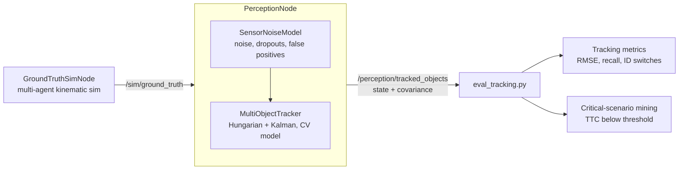

# TacticalDrive Live: real-time perception and scenario mining for ADAS

A Python prototype of the perception half of an ADAS behavior-planning stack. Simulated multi-agent traffic goes through a realistic sensor-noise model. A multi-object tracker (Hungarian assignment plus a per-track Kalman filter) turns the noisy detections into uncertainty-aware tracks. Those tracks are mined for safety-critical scenarios with time-to-collision. Everything talks over a pub/sub bus that mirrors ROS2's node/topic/QoS model, so the core ports to `rclpy` without changes.

**Stack:** Python 3.10+ · NumPy · SciPy (`linear_sum_assignment`) · FilterPy (Kalman filters) · ROS2-style pub/sub with QoS

## Results (default 8 s episode, 20 Hz, seed 0)

| Metric | Value |
| --- | --- |
| Recall vs. ground truth | **99.4%** (636 / 640) |
| False positives reaching output | **0** |
| ID switches | **0** |
| Position RMSE | **0.28 m** |

Reproduce with `PYTHONPATH=. python3 scripts/eval_tracking.py`. The output is deterministic for a given seed.

## Architecture



All arrows are topics on `bus/topic_bus.py`, a small pub/sub layer with ROS2-style QoS: bounded history depth and deadline monitoring that records missed publish deadlines.

```
tacticaldrive-live/
├── bus/topic_bus.py              # ROS2-style pub/sub + QoS (history depth, deadline_ms)
├── sim/ground_truth_sim.py       # multi-agent kinematic sim → /sim/ground_truth
├── perception/perception_node.py # SensorNoiseModel, MultiObjectTracker, PerceptionNode
├── scripts/eval_tracking.py      # tracking metrics + TTC-based scenario extraction
└── docs/ros2_port.md             # line-by-line mapping to rclpy and DDS QoS
```

## Run it

```bash
pip install -r requirements.txt

PYTHONPATH=. python3 perception/perception_node.py   # smoke test: prints one frame of tracks
PYTHONPATH=. python3 scripts/eval_tracking.py         # full episode, metrics, scenario mining
```

## Design decisions

- **Tracks carry covariance, not just a point estimate.** A downstream planner should treat other agents' state as a belief rather than ground truth (the POMDP view). Many tracking demos skip this.
- **Confirmed-track gating (`hits >= 2`).** Single-frame false positives never reach the planner. It trades one frame of latency for a lot of stability, which is why zero false positives make it to the output above.
- **Scenario mining runs on perception output, not ground truth.** A real fleet-data pipeline has no ground truth to mine against, so the extraction logic is tested against noisy tracker output.
- **Business logic is transport-agnostic.** `SensorNoiseModel` and `MultiObjectTracker` don't depend on the bus. They're plain classes over dicts and NumPy arrays, testable without any pub/sub machinery and portable to `rclpy` unchanged. See [docs/ros2_port.md](docs/ros2_port.md).
- **Real-time discipline.** Topics can declare a `deadline_ms`, and the bus records every missed publish deadline. This mirrors DDS deadline QoS.

## Roadmap

1. **Behavior planner node:** an FSM or behavior-tree baseline that subscribes to `/perception/tracked_objects` and publishes `/planning/decision`.
2. **Imitation-learned planner:** behavior cloning on logged episodes, an explicit distribution-shift failure demo, then a DAgger fix.
3. **Safety-cage wrapper:** a rule-based override around the learned policy, using the TTC thresholds from `eval_tracking.py`.
4. **C++ inference node:** export to ONNX, build a C++ ROS2 node, and benchmark Python vs. C++ p50/p99 latency.
5. **Live dashboard:** a FastAPI + WebSocket bridge off the topic bus, with a React front end showing live tracks, planner decisions and latency.
